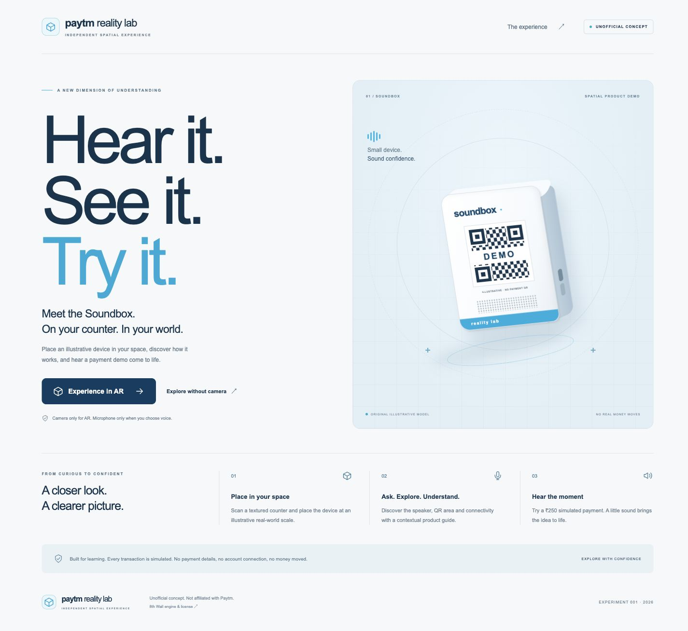

# Paytm Reality Lab

**Hear it. See it. Try it.** An independent mobile-first spatial product learning prototype: place an original illustrative Soundbox, explore its features, ask a private ElevenLabs guide, and try an unmistakably **SIMULATED — NO MONEY MOVED** payment.

Not affiliated with or endorsed by Paytm. No actual payment, merchant account, UPI collection, payment QR or Paytm transaction API. The approximate procedural model is not an official product render or a specific commercial device.



## Run locally

Requires Node 22.18+ (tested Node 26.7.0), npm and a WebGL-capable browser.

```sh
npm ci
npm run dev
```

Open http://localhost:5173. The one command starts Vite (5173) and the Express API (127.0.0.1:3001) with a same-origin proxy. Start individually with `npm run dev:web` and `npm run dev:api`. Environment values are loaded from optional .env. Paid voice is disabled by default. Choose **Explore without camera** for a labelled virtual tabletop; choose **Experience in AR** on supported mobile HTTPS for real engine tracking. Camera and microphone permissions are separate, explicit actions.

```sh
npm run typecheck
npm run build
npm test
npx playwright install chromium webkit
npm run test:e2e
```

`npm ci` copies the complete unmodified 8th Wall 1.0.0 binary and license into public/. `npm run build` typechecks, builds and hash-checks all 13 engine runtime artifacts in dist. Vendor binaries are generated, not tracked. No API keys are part of the client bundle.

Production single server: `npm run build`, then `npm start` and put a trusted HTTPS reverse proxy in front of port 3001. Set APP_ORIGIN to the exact public HTTPS origin. The server binds loopback intentionally. For containers configure an explicit proxy/bind policy rather than exposing the development server.

Vercel: import this repository; build command `npm run build`, output `dist`; the `api/voice/*.mjs` Functions serve API requests using server/app.mjs. Configure server environment variables in hosting settings. Leave VOICE_ENABLED=false until the distributed rate-limit/user-authentication limits in docs/VOICE_SETUP.md are addressed. No deployment was performed as part of this build.

## Live voice setup

Copy `.env.example` to `.env`. Configure a private authenticated ElevenLabs agent and server-only credentials, strong SESSION_SECRET and DEMO_ACCESS_CODE. Export/attach the knowledge base, register blocking client tools and review retention/budgets as described in [Voice setup](docs/VOICE_SETUP.md). No credentials or actual agent were supplied for this build; live voice is **NOT TESTED**. Missing configuration displays “Demo mode (voice AI unavailable)” and leaves buttons and source-backed FAQs usable.

## What works / evidence boundaries

- Onboarding, original CSS hero, lazy procedural Three model, orbit practice view, scale/rotation, source-backed feature/FAQ controls, safe responsive UI and synthetic receipt.
- Real XR8 integration: sole SDK camera/render loop, stable measured horizontal support, world-scene anchor, tracking loss/recovery, reposition and resource cleanup. Physical iPhone/Android behaviour remains **UNVERIFIED**.
- Runtime-validated, amount-limited and idempotent simulation; same service for UI and allowlisted voice tools. Success/failure/reset paths and original browser TTS demo announcement.
- ElevenLabs current React provider/hooks integration, contextual updates, microphone opt-in, mute/stop/reconnect, transcript and authenticated signed-URL backend. Provider/phone tests remain required.
- See [Verification](docs/VERIFICATION.md) for factual test results and environment blockers, [Device checklist](docs/DEVICE_TEST_CHECKLIST.md), [Security](docs/SECURITY.md), [Privacy](docs/PRIVACY.md), and [Architecture/provenance](docs/ARCHITECTURE.md).

## Sources and rights

Product FAQs cite official [what is a Soundbox](https://business.paytm.com/support/what-is-a-soundbox), [how it works](https://business.paytm.com/support/how-does-the-soundbox-work), and [product range](https://business.paytm.com/soundbox), retrieved 18 November 2026. No unverified current price, settlement-time, offline-operation or exact battery claims.

AR support logic and preparation patterns adapted from the same owner's Thiri reference at a9f00dd9c88229caf650a8c021d3053ec4cbf440. No modifications or pushes to that reference. Runtime notices remain in [public/licenses/NOTICE.txt](public/licenses/NOTICE.txt). The 8th Wall binary is governed by its XR Engine License Agreement, **not MIT**; Three.js retains its MIT notice. No proprietary Paytm audio, device photograph or model was copied.
